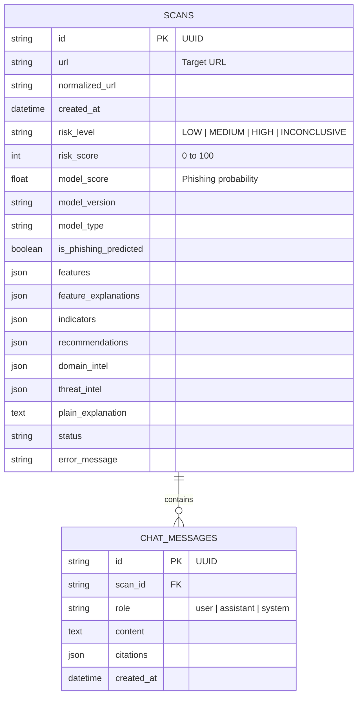

# FraudLens AI — Architecture & System Design

## 1. High-Level System Architecture

FraudLens AI is designed as a defense-in-depth cybersecurity platform that combines deterministic lexical analysis, trained machine learning, explainable AI (SHAP), secure network handshakes, threat intelligence feeds, and a LangGraph multi-agent orchestration workflow.

```
                           +--------------------------------+
                           |   React + TypeScript Frontend   |
                           |  (Cyber Dashboard & Forensic UI)|
                           +---------------+----------------+
                                           | HTTP REST / JSON
                                           v
                           +--------------------------------+
                           |        FastAPI Backend         |
                           |   (SSRF Guard & API Router)    |
                           +---------------+----------------+
                                           |
                                           v
               +-------------------------------------------------------+
               |         LangGraph Multi-Agent State Machine           |
               +-------------------------------------------------------+
                |          |           |            |               |
                v          v           v            v               v
           [Component 1] [Component 2] [Component 3] [Component 4] [Component 5]
           URL Lexical   Domain & DNS  ML Inference Deterministic   Explanation &
           Extractor     Handshake     & TreeSHAP   Risk Engine     RAG Assistant
                |              |           |            |               |
                +--------------+-----------+------------+---------------+
                                           |
                                           v
                           +--------------------------------+
                           |  PostgreSQL / SQLite Storage   |
                           |  (Scans, Evidence, RAG Chats)  |
                           +--------------------------------+
```

---

## 2. Core Functional Components

### Component 1: URL Analysis & Lexical Feature Extraction
- **Scope**: Evaluates strictly URL-only features without making HTTP calls to untrusted target websites.
- **SSRF Prevention**: Enforces supported URL schemes (`http`, `https`). Prohibits dangerous schemes like `file://`, `ftp://`, or `javascript:`.
- **Lexical Extraction**: Extracts 22 mathematical and structural indicators matching the PhiUSIIL schema (URLLength, DomainLength, IsDomainIP, TLDLength, NoOfSubDomain, HasObfuscation, NoOfObfuscatedChar, ObfuscationRatio, LetterRatio, DigitRatio, SpecialCharRatio, Shannon Entropy, etc.).

### Component 2: Safe Domain Intelligence & SSRF-Protected Handshake
- **Safe DNS Resolver**: Queries `A`, `AAAA`, `MX`, `TXT`, and `NS` records with strict query timeouts.
- **SSRF Blocklist Enforcement**: Every resolved IP address is verified against RFC 1918 private subnets (`10.0.0.0/8`, `172.16.0.0/12`, `192.168.0.0/16`), loopback (`127.0.0.0/8`, `::1`), link-local (`169.254.0.0/16`), multicast, and cloud metadata endpoints (`169.254.169.254`). Revalidated prior to connection to defeat DNS-rebinding attacks.
- **TLS Certificate Handshake**: Performs low-level TLS handshake on port 443 to inspect Subject Alternative Names (SANs), Issuer, and validity dates without downloading any webpage body.
- **Server Geolocation**: Resolves external IP to autonomous system number (ASN), ISP, and geographic coordinates.

### Component 3: Machine Learning & Explainable AI (SHAP)
- **Model**: Random Forest classifier trained on 235,000+ benchmark URLs from the official UCI PhiUSIIL dataset.
- **Output**: Calibrated phishing likelihood probability $P(\text{Phishing} = 1) \in [0.0, 1.0]$.
- **Explainability**: TreeSHAP generates exact local feature attributions for every scan, distinguishing factors that elevate risk from those indicating legitimate behavior.

### Component 4: Deterministic Risk Assessment Rules Engine
- **Philosophy**: Automated detection must be transparent, testable, and evidence-based.
- **Rule Precedence**:
  1. `RULE_THREAT_INTEL_CONFIRMED`: A verified match in Google Safe Browsing or PhishTank immediately escalates risk to `HIGH`. Machine learning scores cannot override confirmed threat matches.
  2. `RULE_IP_HOSTNAME`: Hostnames utilizing raw IP literals trigger immediate high-risk alerts.
  3. `RULE_SSRF_INTERNAL_DESTINATION`: Destinations resolving to internal infrastructure trigger a critical alert.
  4. `RULE_SUSPICIOUS_KEYWORDS`: Security keywords combined with anomalous subdomains escalate risk.
  5. `RULE_NO_HTTPS`: Unencrypted transport adds baseline vulnerability points.
- **Classification Output**: `LOW`, `MEDIUM`, `HIGH`, `INCONCLUSIVE`.

### Component 5: Grounded Explanation & RAG Security Assistant
- **RAG Architecture**: Ingests trusted cybersecurity guidance from CISA (Alert AA22-216A), OWASP Phishing Defense, and NIST SP 800-63B / SP 800-177.
- **Grounded Answering**: Evaluates the specific scan evidence alongside retrieved guidance chunks to answer user questions without hallucinating threat intelligence matches.
- **Incident Response Advice**: Recommends immediate remediation steps (password reset on authentic service, session revocation, FIDO2/WebAuthn phishing-resistant MFA enrollment).

---

## 3. Database Schema


